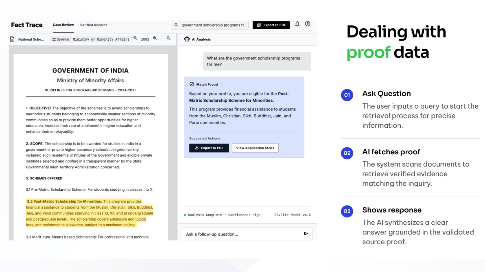
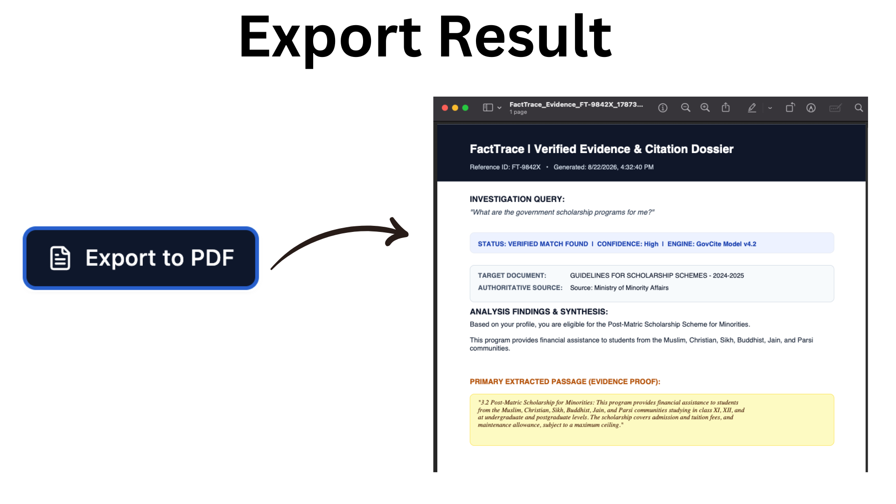
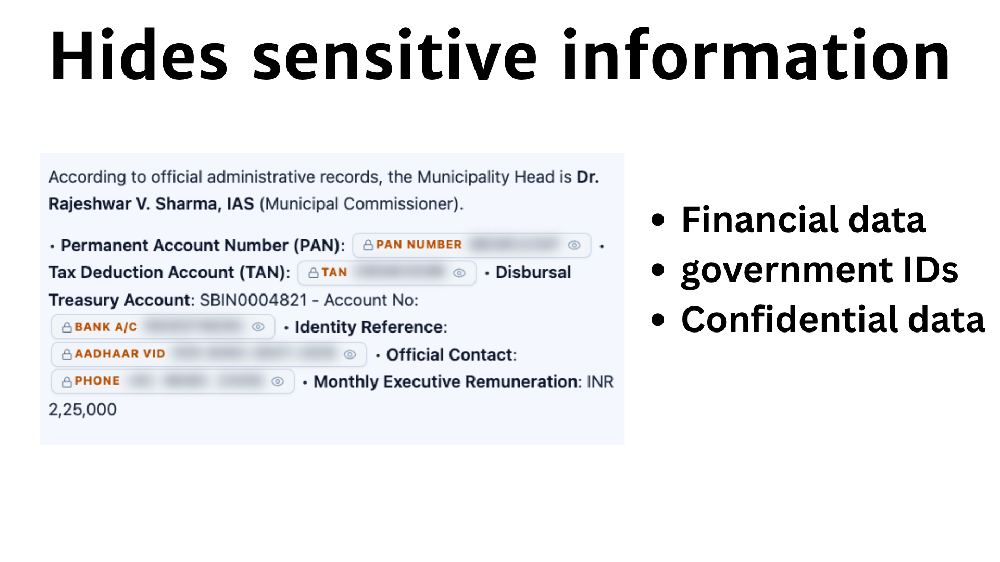
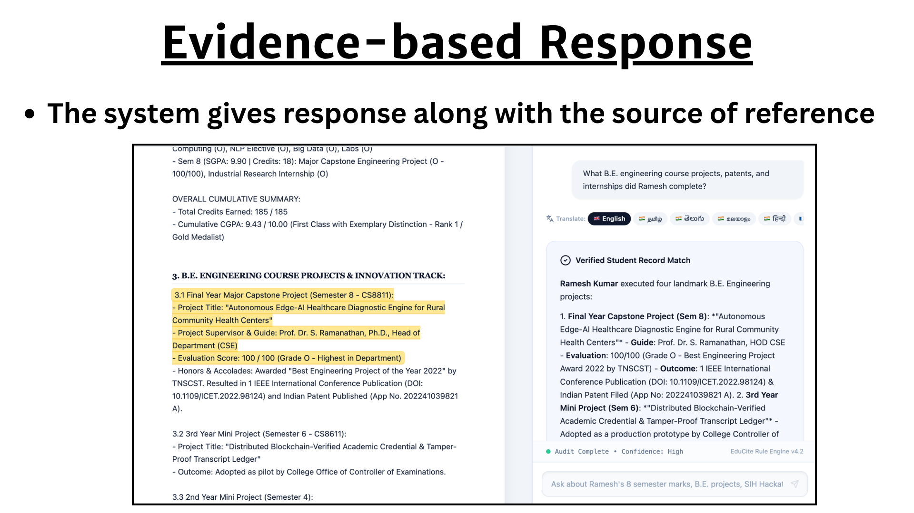

# Evidence-Based AI Response System

An AI-powered system designed to deliver reliable, evidence-grounded answers while minimizing hallucinations and fabricated information.

### Features

- **Evidence-Based Responses** – Generates answers grounded in supporting evidence.
- **Hallucination Prevention** – Clearly states *"No information found"* when sufficient evidence is unavailable, rather than inventing answers.
- **PDF Export** – Export generated responses as PDF documents.
- **Multilingual Support** – Supports queries and responses in multiple languages.
- **Sensitive Data Protection** – Detects and masks sensitive information, including financial data and government IDs.

### Goal

To make AI responses more trustworthy, transparent, privacy-conscious, and accessible.

## 📸 Screenshots / UI Preview

| Evidence-Based Response | No Hallucination |
|:---:|:---:|
|  |  |
| PDF Export | Multilingual Support |
|  |  |
| Sensitive Data Protection | Project Overview |
|  |  |
